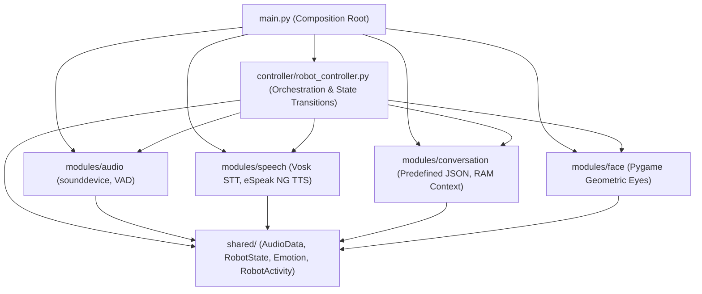

# 01 — Project Structure & Module Isolation Guide

This document details the package structure of **Lumi** (`lumi-robot`). The system is intentionally small and simple for the PC MVP, while enforcing strict module boundaries so speech engines, conversation providers, display backends, and hardware drivers can evolve independently.

---

## 1. High-Level Dependency Graph

Modules never call or import each other. Only `RobotController` orchestrates across modules, and `main.py` wires concrete implementations at startup.



---

## 2. Repository & Package Layout

```text
Lumi.Robot/
├── pyproject.toml                       # Package metadata, dependencies, JSON package-data, `lumi` script
├── README.md                            # Setup, model acquisition, run & test commands
├── .env.example                         # Environment configuration template
├── .gitignore
├── docs/                                # Engineering documentation, specs, and plans
│   ├── README.md
│   ├── 00-getting-started.md
│   ├── 01-project-structure.md
│   ├── 02-python-architecture-and-conventions.md
│   ├── 03-audio-and-offline-speech.md
│   ├── 04-conversation-and-face-engine.md
│   ├── 05-adding-a-feature.md
│   ├── 06-testing.md
│   ├── 07-environments-and-config.md
│   ├── 08-manual-test-checklist.md
│   ├── plans/
│   │   └── README.md
│   └── specs/
│       └── features/
│           ├── README.md
│           ├── 00-foundation.md
│           ├── 01-audio-io-and-vad.md
│           ├── 02-offline-persian-speech.md
│           ├── 03-conversation-and-context.md
│           ├── 04-face-renderer-and-animations.md
│           ├── 05-robot-controller-and-loop.md
│           └── 06-testing-packaging-and-pi-readiness.md
├── src/
│   └── lumi/
│       ├── __init__.py
│       ├── main.py                      # Composition root & lifecycle management
│       ├── shared/                      # Cross-module contracts & enums ONLY
│       │   ├── __init__.py
│       │   ├── models/
│       │   │   ├── robot_state.py       # RobotState(activity, emotion)
│       │   │   └── audio_data.py        # AudioData(samples, sample_rate, channels, sample_width)
│       │   └── enums/
│       │       ├── emotion.py           # NEUTRAL, HAPPY, SAD, ANGRY, SURPRISED
│       │       └── robot_activity.py    # IDLE, LISTENING, THINKING, SPEAKING
│       ├── controller/
│       │   ├── __init__.py
│       │   └── robot_controller.py      # Activity state machine & turn orchestration
│       └── modules/
│           ├── audio/                   # sounddevice capture/playback & VAD
│           ├── speech/                  # Vosk STT & eSpeak NG TTS
│           ├── conversation/            # Persian normalization, JSON rules, RAM context, OpenAI seam
│           └── face/                    # Pygame eye renderer & animations
└── tests/                               # Independent unit tests + fake-driven controller tests
```

---

## 3. Layer & Module Breakdown

### 3.1 `lumi.shared`
Contains **only** cross-module data contracts and enums (`AudioData`, `RobotState`, `Emotion`, `RobotActivity`). Zero third-party library dependencies and zero imports from `modules/` or `controller/`.

### 3.2 `lumi.modules.audio`
- `audio_config.py`: `AudioConfig` dataclass (`16000 Hz`, mono, `int16`, VAD threshold, timeouts).
- `audio_devices.py`: PortAudio device listing and lookup by index/name.
- `audio_service.py`: `AudioService` implementing `record_utterance()` (Auto-VAD + manual tap) and chunked, cancellable `play_audio()`.

### 3.3 `lumi.modules.speech`
- `speech_config.py`: `SpeechConfig` (Vosk model path, `espeak-ng` binary/voice/speed, timeouts).
- `speech_to_text.py` & `providers/vosk_stt_provider.py`: Converts `AudioData -> str`.
- `text_to_speech.py` & `providers/espeak_tts_provider.py`: Converts `str -> AudioData` (never plays directly).

### 3.4 `lumi.modules.conversation`
- `conversation_models.py` & `conversation_provider.py`: Local `ConversationMessage`, `ConversationReply`, and async `ConversationProvider` protocol.
- `context/conversation_context.py` & `conversation_context_manager.py`: Bounded 20-message RAM window, `pending_intent`, `clear_history()`.
- `conversation_service.py`: Async `respond(user_text)` orchestrating context updates and provider calls.
- `providers/predefined/`: Persian text normalizer (`predefined_intent_matcher.py`), contextual rule engine (`predefined_rule_engine.py`), anti-repetition `PredefinedProvider`, and packaged `data/intents.json` + `data/responses.json`.
- `providers/openai/openai_provider.py`: Future extension stub (`NotImplementedError` in MVP).

### 3.5 `lumi.modules.face`
- `face_config.py`: Display dimensions (`480×320` window scaled from `320×240` logical grid), colors, FPS, blink/transition timing.
- `face_animations.py`: Delta-time (`dt`) blinking, eye saccades, smooth emotion interpolation, and activity motion overlays.
- `face_renderer.py`: Asset-free geometric drawing of two eyes and activity cues.
- `face_service.py`: Main-thread Pygame loop, thread-safe `set_state(RobotState)`, and `QUIT`/`SPACE` callbacks.

### 3.6 `lumi.controller` & `lumi.main`
- `robot_controller.py`: Dedicated worker-thread `asyncio` loop managing half-duplex `IDLE -> LISTENING -> THINKING -> SPEAKING -> IDLE` transitions, timeouts, barge-in cancellation, and error recovery.
- `main.py`: Builds configs, instantiates concrete services, injects them into `RobotController`, runs controller thread + main-thread `FaceService.run()`, and guarantees clean teardown.
