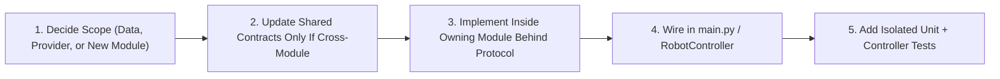

# 05 — Guide to Adding a Feature or Provider

This guide shows how to extend **Lumi** with new capabilities—such as new Persian conversation intents, an alternative TTS/STT/LLM provider, a new `Emotion`, or a future hardware module (motors, sensors, camera)—while preserving module independence.

---

## Extension Workflow in 5 Steps

---

## Scenario A: Adding Persian Intents & Responses (No Code Changes)
1. Add normalized keywords/phrases and priority to `src/lumi/modules/conversation/providers/predefined/data/intents.json`.
2. Add multiple varied Persian templates (with `emotion` and optional `next_pending_intent`) to `responses.json`.
3. Add matching assertions in `tests/test_predefined_intent_matcher.py` and `tests/test_predefined_provider.py`.

---

## Scenario B: Swapping a Provider (e.g., Piper TTS or OpenAI Conversation)
1. Keep the existing protocol (`TextToSpeechProvider`, `SpeechToTextProvider`, or `ConversationProvider`) unchanged.
2. Add a new provider class under `src/lumi/modules/<module>/providers/<provider_name>/`.
3. Add a configuration selector in `main.py` (e.g., `LUMI_CONVERSATION_PROVIDER=openai`) to instantiate the new provider while keeping the offline default intact.
4. Keep any new SDK dependencies isolated inside that provider (and optional in `pyproject.toml` if cloud-only).
5. Verify `RobotController` works unchanged with the new provider via unit/integration tests.

---

## Scenario C: Adding a New Hardware Module (Post-MVP, e.g., Motors or Wake Word)
1. Create a dedicated package under `src/lumi/modules/<new_module>/` with its own `*_config.py`, `*_service.py`, and protocol.
2. Only add enums/models to `src/lumi/shared/` if multiple modules or `RobotController` must share them.
3. Never import `audio`, `speech`, `conversation`, or `face` from the new module—route all coordination through `RobotController`.
4. Ensure desktop simulation continues to run cleanly with a no-op/fake adapter when physical hardware is absent.
5. Add unit tests for the module and integration coverage in `tests/test_robot_controller.py`.
