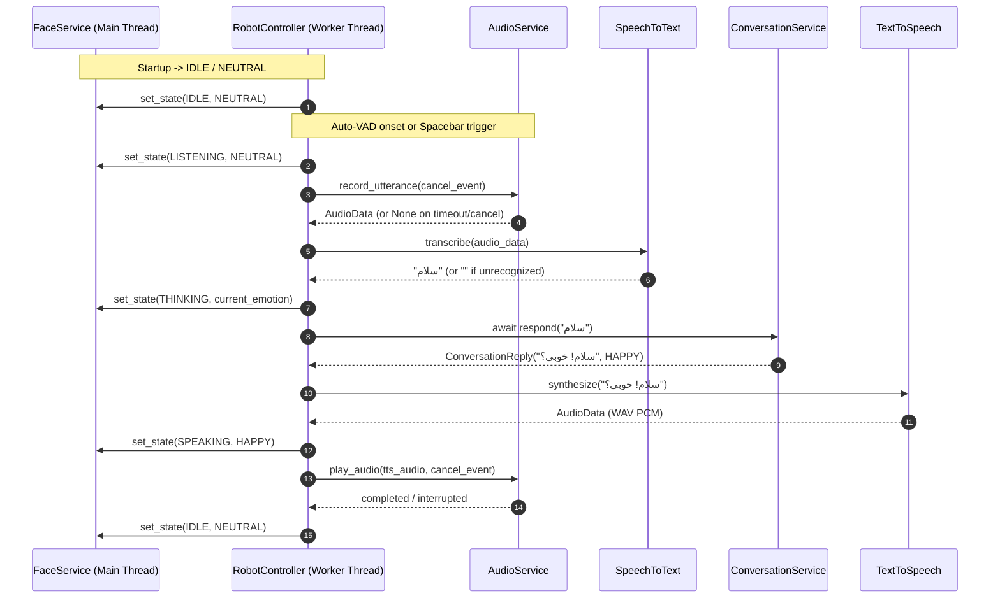

# Feature 05 — RobotController & End-to-End Interaction Loop

**Feature Identifier:** `FEAT-05`  
**Layer Focus:** `src/lumi/controller/robot_controller.py`  
**Shared Contracts Used:** `AudioData`, `RobotState`, `Emotion`, `RobotActivity`  
**Deliverable:** Orchestration state machine coordinating `Audio`, `Speech`, `Conversation`, and `Face` with half-duplex safety, cancellation, timeouts, and error recovery  

---

## 1. Overview & Business Value

`RobotController` is the single coordinator connecting Lumi's four independent modules. It owns every `RobotActivity` transition, routes `AudioData` and text across module boundaries, enforces half-duplex speaking safety, and guarantees Lumi never gets stranded in `LISTENING`, `THINKING`, or `SPEAKING` when hardware fails, speech is empty, or the user interrupts.

---

## 2. State Machine & Interaction Flow

### 2.1 State Transition Rules
| From | Trigger / Condition | To | Notes |
|---|---|---|---|
| `IDLE` | Auto-VAD detects voice onset (`on_speech_onset`) or `Space` pressed | `LISTENING` | In `auto_vad`, Lumi remains visually `IDLE` until voice onset triggers `on_speech_onset`; in `push_to_talk`, waits in `IDLE` until `Space`. |
| `LISTENING` | `AudioData` captured → `STT.transcribe(audio)` returns non-empty text | `THINKING` | Runs `STT.transcribe(audio)` right after capture; enters `THINKING` only when non-empty text is recognized (matching Brief §6 steps 3–4). |
| `LISTENING` | Timeout (`None`), noise-only, empty STT (`""`), or cancelled | `IDLE` | Resets to `RobotState(IDLE, NEUTRAL)` with a brief cooldown (`~0.15s`) before the next Auto-VAD wait cycle. |
| `THINKING` | `ConversationService` returns reply + `TTS` succeeds | `SPEAKING` | Updates `FaceService` with `RobotState(SPEAKING, reply.emotion)` right as playback starts. |
| `THINKING` | Conversation/TTS error or timeout | `IDLE` | Logs error with context, resets to `RobotState(IDLE, NEUTRAL)`, never hangs. |
| `SPEAKING` | Playback completes naturally | `IDLE` | Resets to `RobotState(IDLE, NEUTRAL)` (half-duplex: mic is not feeding STT during `SPEAKING`). |
| `SPEAKING` | `Space` barge-in | `LISTENING` | Cancels playback immediately (`<150ms`) and enters `LISTENING` (`wait_for_speech=False`) to capture the interrupting utterance directly. |

---

## 3. Concurrency, Cancellation & Trigger Policy

### 3.1 Worker Thread + Asyncio Isolation
- `RobotController.start()` runs an `asyncio` event loop inside a dedicated daemon/managed worker thread (`lumi-controller`).
- Blocking synchronous module operations (`AudioService.record_utterance`, `SpeechToText.transcribe`, `TextToSpeech.synthesize`, `AudioService.play_audio`) execute via `await asyncio.to_thread(...)` so the controller loop remains responsive to shutdown and cancellation signals.
- `ConversationService.respond(...)` runs natively on the controller's `asyncio` loop.
- `FaceService.set_state(...)` is the sole cross-thread call into `face`, protected by `face`'s internal lock.

### 3.2 Manual `Space` Trigger & Barge-In Semantics
The `Space` key tap callback (`KEYDOWN SPACE`) from `FaceService` maps to `RobotController.on_manual_trigger()` (thread-safe):
- **When `IDLE`:** Immediately starts an active recording turn (`LISTENING`, `wait_for_speech=False`), even in `push_to_talk` mode or while `auto_vad` is waiting for onset.
- **When `LISTENING`:** Sets the active turn's `stop_event` to finalize and submit any speech captured so far immediately (without waiting for trailing silence timeout).
- **When `SPEAKING`:** Sets the active turn's `cancel_event`, halting `AudioService.play_audio()` immediately (`<150ms`), and transitions directly into `LISTENING` (`wait_for_speech=False`) so the user can speak right away.

### 3.3 Timeouts & Graceful Shutdown
- Per-stage timeouts prevent hangs:
  - Audio capture timeout (`AudioConfig.speech_start_timeout_seconds` + `max_utterance_seconds`)
  - STT / Conversation / TTS turn timeout (configurable, e.g., `15.0s`)
- `RobotController.stop(timeout=3.0)` sets global shutdown `Event` + active turn `cancel_event`, stops the worker loop, joins the thread cleanly, and calls `audio.close()`.

---

## 4. Error Recovery Matrix

| Failure Scenario | Expected Controller Behavior |
|---|---|
| Empty/unrecognized STT (`""` or whitespace) | Skip Conversation & TTS; return to `IDLE` (`NEUTRAL`), ready for next turn. |
| Audio capture returns `None` (silence timeout) | Return to `IDLE` without error spam; resume Auto-VAD if enabled. |
| Audio device unavailable / disconnected | Log error, set `RobotState(IDLE, SAD)` (or `NEUTRAL`), wait briefly before retry or surface clean fatal error at startup. |
| TTS synthesis raises `SpeechSynthesisError` | Log error, skip playback, recover to `IDLE` (`NEUTRAL`) so robot stays responsive. |
| Conversation provider error | Log error, recover to `IDLE` (`NEUTRAL`) without crashing the loop. |

---

## 5. Acceptance Criteria

1. Using fake `Audio`, `Speech`, `Conversation`, and `Face` implementations, `RobotController.run_single_turn()` transitions strictly through `IDLE -> LISTENING -> THINKING -> SPEAKING -> IDLE` and forwards `ConversationReply.emotion` to `FaceService` during `SPEAKING`.
2. Empty STT transcripts short-circuit before calling `ConversationService` or `TextToSpeech` and recover to `IDLE`.
3. Errors in `Audio`, `STT`, `Conversation`, or `TTS` never crash the controller loop or leave `FaceService` stuck in `THINKING`/`SPEAKING`.
4. Triggering barge-in (`on_manual_trigger()`) during `SPEAKING` cancels playback promptly and returns cleanly.
5. `RobotController.stop()` terminates the worker thread cleanly within timeout with no dangling tasks.
